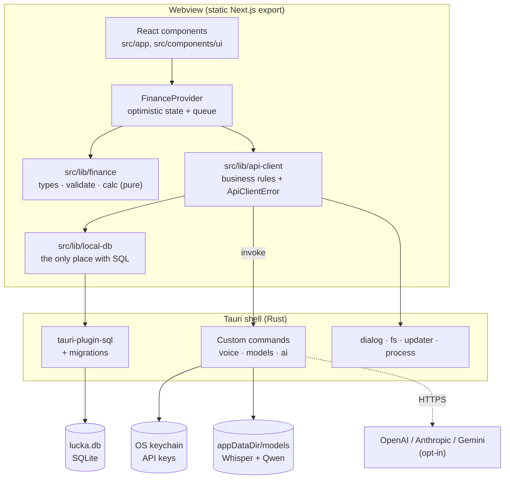
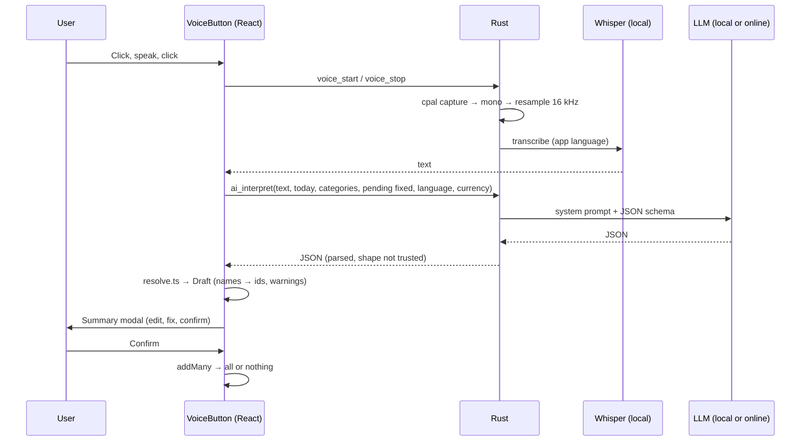
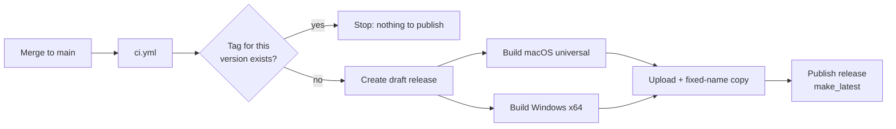
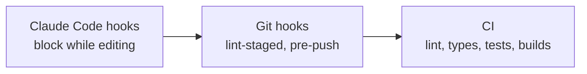

# Architecture

How Lucka works, layer by layer, and why it was built this way.

Short version: [the two-minute video](architecture-video/lucka-architecture.mp4). Source: `docs/architecture-video/index.html`.

- [1. Overview](#1-overview)
- [2. Repo map](#2-repo-map)
- [3. Frontend (Next.js)](#3-frontend-nextjs)
- [4. Desktop shell (Tauri + Rust)](#4-desktop-shell-tauri--rust)
- [5. Data layer (SQLite)](#5-data-layer-sqlite)
- [6. AI and voice](#6-ai-and-voice)
- [7. Quality gates and CI/CD](#7-quality-gates-and-cicd)
- [8. AI-assisted development (Claude Code)](#8-ai-assisted-development-claude-code)
- [9. Testing](#9-testing)
- [10. Trade-offs and known limits](#10-trade-offs-and-known-limits)
- [11. Releasing a version](#11-releasing-a-version)

---

## 1. Overview

Lucka is a personal finance desktop app for macOS and Windows.
It answers one question: **how much money do I have left until my next paycheck?**

Core principles:

- **Local-first.** One SQLite file on the user's machine. No server, no account, no cloud.
- **Private by default.** Data never leaves the computer. The only opt-in exception is voice entry with an online AI provider (see [§6](#6-ai-and-voice)).
- **Web UI, native shell.** The UI is a static Next.js site. Tauri wraps it in a native window and exposes a small, permission-scoped Rust API.
- **Two languages, two currencies.** English or Spanish, US dollars or Colombian pesos. Picked on first launch.

Origin: Lucka started as a Next.js + Supabase web app with login and end-to-end encryption.
It was ported to desktop by removing auth, encryption and the server, and turning SQLite into the "backend".
The public API of the front-end data client was kept identical, so the UI barely changed.



---

## 2. Repo map

| Path                      | What lives there                                                                         |
| ------------------------- | ---------------------------------------------------------------------------------------- |
| `src/app/`                | Routes. Single-use components live next to their route.                                  |
| `src/app/(app)/`          | The app: onboarding, dashboard, editors, settings, voice.                                |
| `src/components/ui/`      | Shared UI: button, modal, money input, day picker, progress, icons.                      |
| `src/lib/finance/`        | Domain types, input validation, pure calculations and money formatting.                  |
| `src/lib/i18n/`           | Every text in the app (`en.ts`, `es.ts`), languages and currencies.                      |
| `src/lib/api-client/`     | What the UI calls. Business rules, errors, Tauri calls.                                  |
| `src/lib/local-db/`       | One file per table. **The only place with SQL.**                                         |
| `src/lib/ai/`             | AI provider catalog and the AI-output → draft resolver.                                  |
| `src/lib/dashboard/`      | Widget layout logic (order, size, visibility).                                           |
| `src-tauri/src/`          | Rust: app setup, voice recorder, local models, AI providers.                             |
| `src-tauri/migrations/`   | SQL migrations, run on startup.                                                          |
| `src-tauri/capabilities/` | Tauri permissions for the webview.                                                       |
| `scripts/`                | Build helper that bundles llama.cpp native libraries.                                    |
| `eslint-rules/`           | Custom lint rules that enforce house conventions.                                        |
| `.claude/`                | Claude Code hooks, agents and skills (see [§8](#8-ai-assisted-development-claude-code)). |
| `.github/workflows/`      | CI, build check and release pipelines.                                                   |

---

## 3. Frontend (Next.js)

### Static export

- `next.config.ts`: `output: 'export'` → the build is plain files in `out/`. Tauri serves them.
- `trailingSlash: true` → `/settings/index.html`. The webview resolves folders, not extensionless paths.
- `images.unoptimized` → no image server.
- No server features: no `cookies()`, `headers()`, route handlers or server actions. They break the export.
- Routes: `/` (onboarding or dashboard) and `/settings`. A React `ViewTransition` fades between them.

### Layers inside the UI

1. **Components** render and collect input. They never touch data directly.
2. **`FinanceProvider`** (`src/app/(app)/finance-provider.tsx`) owns the app state.
3. **`src/lib/finance/`** is pure: no I/O, easy to test.
4. **`createFinanceApi()`** (`src/lib/api-client/finance.ts`) is the only door to persisted data.

### State: optimistic updates with a queue

Every user action goes through `run(plan)`:

1. A `plan` receives the latest snapshot and returns either an error string or `{ next, save }`.
2. `next` is shown immediately (optimistic UI).
3. `save(api)` persists it.
4. If saving fails, the previous snapshot is restored and the error is returned to the component.

Details that matter:

- Actions are chained in a promise **queue**. Each one starts from the state the previous one left, so fast clicks never race.
- The latest snapshot lives in a `ref`, not only in React state, so queued actions never read a stale closure.
- Every action returns `Promise<string | null>`: the message to show, or `null` on success.
- `ready` stays `false` while loading, so a returning user never sees the onboarding flash.

### Validation

- `src/lib/finance/validate.ts` returns a `Result<T>` (`{ ok: true, value } | { ok: false, error }`). No exceptions for expected errors.
- Input is treated as `unknown`. Money must be a safe integer, days 1–31, ids UUIDs, dates `YYYY-MM-DD`.
- Errors are codes (`ErrorCode`), not text. The UI translates them (`errorText` in `src/lib/api-client/http.ts`).
- The same validators are reused by the backup importer ([§5](#backup-json)).

### Domain logic (`src/lib/finance/calc.ts`)

The financial month runs **from payday to payday**, not calendar month.

- `getCycle(payday, today)` returns `[start, end)`.
  - If payday is the 31st and the month has 30 days, it falls on the 30th.
  - Month overflow (`month = -1` or `12`) is normalized by `Date`.
- `summarize(data, today)` computes, for the current cycle:
  - **Available** = `monthly income + extra income − spent − pending fixed expenses`.
  - Per fixed expense: paid, pending, `isPaid`.
  - Per category: spent, remaining, over budget, ratio.
  - Days until next payday.
- Every expense goes **either** to a fixed expense (marks it as paid) **or** to a category (counts against its budget).
- The monthly investment contribution is modeled as one more fixed expense (`syncInvestmentFixed`).
- Toggling a fixed expense as paid = insert an expense for what's pending. Unpaid = delete its payments in the cycle.

### Dashboard layout

- Four widgets on a 6-column grid: available, budgets, fixed, recent.
- Users can reorder (drag), resize (drag the edge, snapped to ⅓, ½, ⅔ or full) and hide/show widgets.
- `src/lib/dashboard/layout.ts` holds the pure functions (`move`, `hide`, `show`, `resize`, `snapSize`).
- The layout is a UI preference, so it lives in `localStorage`, not SQLite.
- `loadLayout()` sanitizes whatever it reads: unknown widgets are dropped, missing ones are added, broken JSON falls back to the default.

### Languages and money

- `src/lib/i18n/en.ts` holds every text. `es.ts` is typed against it, so a missing key fails the build.
  - Texts with values are functions (`daysToPayday(n)`). Errors are templates (`'{provider} rejected the key…'`).
  - No i18n library and no `[lang]` routes: the export is static and the language is a saved preference.
- `PreferencesProvider` (`src/app/(app)/preferences-provider.tsx`) loads `{ language, currency }` from SQLite.
  - Nothing renders until it knows them: no flash of the wrong language.
  - No row yet → the system language picks (`es-*` → Spanish, else English), and the currency follows it.
  - `usePreferences()` gives `t` (the dictionary), `money(cents)`, `date(d)`, `error(e)` and the setters.
- Money is **integer cents** for both currencies.
  - `formatMoney` (`src/lib/finance/format.ts`): separators follow the language, decimals follow the currency. COP shows none; USD shows them only when there are some.
  - `MoneyInput` keeps what's being typed ("4.") while it still means the value, so decimals can be typed.
- The onboarding opens with a language and currency step. Settings can change both.
  - The currency locks once there's any expense or income (`savePreferences` → 409 `currencyLocked`). There's no exchange rate to convert old records.

### Styling

- **CSS Modules + design tokens.** No Tailwind, no CSS-in-JS.
- `src/app/globals.css` is the only file allowed to contain literal colors. Everything else uses `var(--token)`.
- Enforced three times: custom ESLint rules, a Claude Code hook and CI ([§7](#7-quality-gates-and-cicd)).
- Font: Plus Jakarta Sans via `next/font`, self-hosted at build time (no external request, CSP-friendly).

---

## 4. Desktop shell (Tauri + Rust)

### Config (`src-tauri/tauri.conf.json`)

- Dev: `pnpm dev` on `localhost:3000`. Build: `pnpm build` → `../out`.
- `identifier: dev.juanramirez.lucka` decides where data lives. Changing it orphans existing data.
- Window: 1280×820, min 960×640.
- **CSP:** `default-src 'self'`, `connect-src ipc:` only. The webview cannot call any external domain. All network calls happen in Rust.
- Bundles: `dmg` + `app` (macOS universal), `nsis` + `msi` (Windows x64).
- Platform overrides: `tauri.macos.conf.json` (frameworks, entitlements, min macOS 11), `tauri.windows.conf.json` (native DLLs as resources).

### Permissions (`src-tauri/capabilities/default.json`)

Least privilege. The webview only gets:

| Permission                                   | Used for                            |
| -------------------------------------------- | ----------------------------------- |
| `sql:default`, `sql:allow-execute`           | Read/write the SQLite file          |
| `dialog:allow-save/open/ask`                 | Export/import backup, confirmations |
| `fs:allow-read-text-file`, `write-text-file` | Backup file only                    |
| `updater:default`, `process:allow-restart`   | Auto-update and relaunch            |

### Rust entry point (`src-tauri/src/lib.rs`)

- Registers plugins: `sql` (with migrations), `dialog`, `fs`, `updater`, `process`.
- Shares state across commands with `.manage(...)`:
  - `reqwest::Client` with only a connect timeout (downloading a 2 GB model takes time).
  - `voice::Engines`: loaded Whisper and LLM models, cached between calls (loading takes seconds).
  - `voice::recorder::Recorder`: the active microphone session.
- On exit, unloads all models. ggml aborts if the process exits with Metal models alive.

### Custom commands

| Command                           | What it does                                           |
| --------------------------------- | ------------------------------------------------------ |
| `voice_start` / `voice_stop`      | Record from the mic; stop transcribes in `language`    |
| `voice_check_mic`                 | Record 0.7 s to trigger the OS permission prompt       |
| `models_status`                   | Catalog of local models and which are installed        |
| `model_download` / `model_delete` | Manage local models on disk                            |
| `ai_save_key` / `ai_delete_key`   | Validate and store / remove an API key in the keychain |
| `ai_interpret`                    | Turn a transcript into structured records              |

- Every command returns `Result<T, AppError>` (`src-tauri/src/error.rs`): a code plus an optional provider name or HTTP status. No text in Rust.
- The front wraps `invoke` in one helper (`call` in `src/lib/api-client/ai.ts`). `nativeError` turns the payload into an `ApiClientError`; unknown codes get the generic message.

### Auto-update

- `tauri-plugin-updater` reads `latest.json` from the latest GitHub Release.
- Updates are signed with a minisign key (secret in CI). The app only installs what that key signed.
- `UpdateBanner` checks on startup. Offline or no release → silently does nothing.
- Install → download, replace, relaunch.

### Shipping llama.cpp (the hard part)

Whisper and llama.cpp both embed **ggml**. Linking both statically causes symbol clashes.
Solution: Whisper is linked statically; llama.cpp is linked **dynamically** and shipped next to the binary.

- `scripts/stage-native-libs.mjs` runs as `beforeBundleCommand`:
  - Finds the freshest `llama-cpp-sys-2` build output (not `target/<profile>`, which can be stale).
  - macOS universal: merges arm64 + x86_64 libraries with `lipo`.
  - Copies them to `src-tauri/libs/`.
- macOS: libs go to `Contents/Frameworks` so Tauri signs them. `build.rs` adds `@executable_path` and `../Frameworks` to the rpath.
- `tauri-build` requires the frameworks to exist at compile time, before the real libs are built. `build.rs` writes empty placeholders.
- Windows: DLLs ship as resources next to the `.exe`.
- `.cargo/config.toml` disables OpenSSL in llama.cpp's CMake. Otherwise it links Homebrew's OpenSSL and the app breaks on machines without it.
- `Entitlements.plist`:
  - `audio-input` for the microphone.
  - `disable-library-validation`: ad-hoc signed apps (no Apple Team ID) with hardened runtime refuse to load the bundled dylibs otherwise.

---

## 5. Data layer (SQLite)

### Where the file lives

| OS      | Path                                                           |
| ------- | -------------------------------------------------------------- |
| macOS   | `~/Library/Application Support/dev.juanramirez.lucka/lucka.db` |
| Windows | `%APPDATA%\dev.juanramirez.lucka\lucka.db`                     |

Settings shows the exact path.

### Schema

| Table              | Holds                                                 |
| ------------------ | ----------------------------------------------------- |
| `preferences`      | One row. Language and currency                        |
| `finance_settings` | One row. Name, income, payday, onboarding state       |
| `fixed_expenses`   | Rent, internet, investment contribution… Soft-deleted |
| `categories`       | Budget categories. Soft-deleted                       |
| `expenses`         | Points to a fixed expense **or** a category           |
| `incomes`          | Extra income (bonus, side jobs)                       |
| `investments`      | One row. Monthly contribution and balance             |
| `ai_providers`     | Configured AIs and the default one. **No keys**       |

The database enforces the rules, not only the app:

- **Single-row tables:** `id INTEGER PRIMARY KEY CHECK (id = 1)`.
- **Exactly one target per expense:** `CHECK ((fixed_expense_id IS NULL) <> (category_id IS NULL))`.
- **At most one active investment fixed expense:** partial unique index `WHERE is_investment = 1 AND archived_at IS NULL`.
- **At most one default AI:** partial unique index `WHERE is_default = 1`.
- Ranges: `payday` and `due_day` 1–31, booleans `IN (0, 1)`.
- Foreign keys on (sqlx enables them per connection).

Conventions:

- Money is `INTEGER` **cents** for every currency. Migration 0003 multiplied the old whole-peso amounts by 100.
- Dates are `TEXT`: `YYYY-MM-DD` for days, ISO 8601 for instants.
- IDs are UUIDs generated in the front (`crypto.randomUUID()`), so optimistic state and the DB share ids.
- **Soft delete** (`archived_at`) for fixed expenses and categories: old expenses still point to them.
- Editing a list (`replaceFixed`, `replaceCategories`) = upsert by id + archive what's missing.

### Migrations

- Files in `src-tauri/migrations/` (`0001_init.sql` … `0003_preferences.sql`), embedded with `include_str!`.
- Registered in `lib.rs` with an increasing version. They run when the DB opens, each one inside a transaction (sqlx).
- A published migration is **never edited**, not even a comment: sqlx checks its checksum and refuses to open the database if it changed.
- `0003_preferences.sql` is one-way: an older app version can't open a database that ran it.

### SQL lives in one place

- `src/lib/local-db/` has one file per resource. No other folder writes SQL.
- `db.ts` opens the connection once and exposes a tiny `Db` interface (`execute`, `select`). Tests mock it without Tauri.
- Row types (`snake_case`) are mapped to domain types (`camelCase`) right there.
- Errors carry an HTTP-like status (`404`, `409`, `422`) via `ApiClientError`, inherited from the web version.

### No transactions (and how it's handled)

`tauri-plugin-sql` uses a connection pool: `BEGIN` and `COMMIT` may land on different connections.
So the app does not use transactions. Accepted risk: local app, single user. Mitigations:

- **Validate everything before writing.** Import parses the whole backup first; the DB is touched only if all of it is valid.
- **Manual compensation.** `addMany` (voice batch) tracks what it inserted and deletes it if a later insert fails, then restores the previous categories.
- **Ordering that respects the indexes.** E.g. clear the old default AI before setting a new one.

### Backup (JSON)

Settings → Export / Import / Delete all.

```json
{
  "version": 2,
  "exportedAt": "2026-10-14T18:00:00.000Z",
  "data": {
    "preferences": { "language": "en", "currency": "USD" },
    "profile": { "name": "…", "monthlyIncome": 420000, "payday": 30 },
    "onboarded": true,
    "investment": null,
    "fixed": [],
    "categories": [],
    "expenses": [],
    "incomes": []
  }
}
```

- Amounts are cents. Version 1 files (whole pesos, no preferences) still import: amounts ×100, Spanish and COP.
- Includes archived fixed expenses and categories: old expenses reference them.
- Import validates shape, `version`, every row, orphan expenses and the "one active investment" rule. Then it replaces everything.
- `ai_providers` and keys are excluded: they depend on the machine.
- Shape change → bump `BACKUP_VERSION` in `src/lib/local-db/backup.ts`.
- Delete-all asks twice: there is no trash and no cloud.

---

## 6. AI and voice

Users can say _"yesterday I spent 15k on coffee, paid the internet and got a 200k bonus"_ and get three records ready to confirm.

### Pipeline



### Speech to text (always local)

- `cpal` captures the default mic on its own thread (its stream is not `Send` on every OS).
- Channels are mixed to mono inside the callback; then linear resampling to 16 kHz (what Whisper expects).
- Guards: < 0.5 s → "didn't hear you"; all-zero samples → macOS silently denied the mic permission; 120 s cap.
- `whisper-rs` (whisper.cpp, Metal on macOS), in the app's language (`en` or `es`). **Audio never leaves the machine.**

### Text to records

One prompt and **one JSON schema** (`src-tauri/src/ai/prompt.rs`) for all four providers:

| Provider  | How the schema is enforced                                                        |
| --------- | --------------------------------------------------------------------------------- |
| Local     | Schema → GBNF grammar (`json_schema_to_grammar`) + greedy sampling with llama.cpp |
| OpenAI    | Responses API, `json_schema` with `strict: true`                                  |
| Anthropic | Messages API, `output_config.format` JSON schema, low effort                      |
| Gemini    | `responseJsonSchema` + `application/json`                                         |

- The schema has every field required and no nulls ("no data" = `""` or `0`). OpenAI strict mode and the local grammar both need that.
- The prompt adapts to the language and the currency:
  - COP: Colombian slang ("20 mil", "una luca", "1,5 millones"). USD: "20 bucks", "$4.50", "a grand".
  - One worked example in the person's language, with amounts in their currency.
  - Descriptions and new category names come back in the app's language.
- Amounts come back as whole money units (`number`, decimals for dollars). `resolve.ts` turns them into cents.
- Context sent: today's date, category names, names of **pending** fixed expenses, the transcript, language and currency.
- Rust only checks that the answer is JSON. The **front** validates the shape.

### Resolving the answer (`src/lib/ai/resolve.ts`)

The AI speaks in names and whole money; the DB stores ids and cents. `resolve()` bridges them and never trusts the input:

- Matches categories ignoring accents and case (`"Café"` = `"cafe "`).
- Unknown category → proposes a new one (once, even if mentioned twice), with the budget the user asked for.
- Fixed expense without amount → uses what's pending. Already paid or unknown → warning, skipped.
- Amounts → cents. Pesos are rounded to whole pesos first. Negative, not a number or too big → warning.
- Unknown type or bad date → warning or today's date.
- Warnings are data (`{ kind, label }`), shown in the app's language by the summary modal.
- The user reviews everything in the summary modal before anything is saved.

### Local models

| Model         | Use           | Size                  |
| ------------- | ------------- | --------------------- |
| Whisper small | Speech → text | ~490 MB (recommended) |
| Whisper base  | Speech → text | ~150 MB               |
| Qwen 2.5 3B   | Text → JSON   | ~2.1 GB (recommended) |
| Qwen 2.5 1.5B | Text → JSON   | ~1.1 GB               |

- Downloaded from Hugging Face into `appDataDir/models`.
- Streamed to a `.part` file while hashing. **SHA-256 and size are pinned** in the catalog; a mismatch is rejected.
- Progress events (`models://progress`) every ~1% to avoid flooding IPC.
- One model per kind on disk. Downloading another replaces the previous one.

### API keys

- Stored in the **OS keychain** (`keyring` crate: Keychain / Credential Manager). Never in SQLite, logs or backups.
- The front sends the key once, when saving. Only Rust reads it afterwards.
- Validated before saving with a free call (list models). A bad key never reaches the keychain.
- Removing a provider deletes its key (or its local model).
- HTTP errors become clear messages: bad key (401/403), unknown model (404), quota (429), offline.
- Model ids are whitelisted characters (they go in Gemini's URL).

### What leaves the machine

| Data                     | Local AI | Online AI                   |
| ------------------------ | -------- | --------------------------- |
| Audio                    | Never    | Never                       |
| Transcript               | Never    | Sent to the chosen provider |
| Category and fixed names | Never    | Sent to the chosen provider |
| Amounts, history, DB     | Never    | Never                       |

The app warns about this before asking for a key.

---

## 7. Quality gates and CI/CD

### One command

```bash
pnpm check   # lint + prettier + types + tests + next build + cargo check
```

A task is not done until it passes.

### Local git hooks (Husky)

- `pre-commit` → `lint-staged`: ESLint `--fix` + Prettier on staged files only.
- `pre-push` → blocks direct pushes to `main`, `staging`, `feedback`.

### ESLint

- Base: `next/core-web-vitals`, `next/typescript`, Prettier.
- Banned: `any`, `@ts-ignore` / `@ts-expect-error` / `@ts-nocheck`, **any** `eslint-disable` comment, `console.log`.
- Three custom rules in `eslint-rules/`:

| Rule                      | What it enforces                                                                                                                   |
| ------------------------- | ---------------------------------------------------------------------------------------------------------------------------------- |
| `kebab-case-filename`     | Every filename segment is kebab-case. Next route segments (`[id]`, `(app)`) allowed. Suggests the fix.                             |
| `no-hardcoded-colors`     | No hex / `rgb()` / Tailwind palette in TS/JSX. Named colors only where they paint (`fill`, `style.color`), not in component props. |
| `no-hardcoded-colors-css` | Same for CSS, using the CSS AST (comments ignored, `var()` fallbacks caught).                                                      |

### GitHub Actions

| Workflow          | Trigger                                    | Does                                                                                                                              |
| ----------------- | ------------------------------------------ | --------------------------------------------------------------------------------------------------------------------------------- |
| `ci.yml`          | PR to `main` / `staging` / `feedback`      | Job `check`: lint, prettier, types, tests, build. Job `rust`: `cargo check` + `clippy -D warnings`                                |
| `build-check.yml` | PR touching `src-tauri/`, `scripts/`, deps | Real macOS universal + Windows build. Verifies the signature, launches the app for 15 s and fails if it crashes. Does not publish |
| `release.yml`     | Push to `main`                             | Reuses `ci.yml`, then publishes if the version is new                                                                             |

`build-check.yml` exists because native-library and signing bugs used to show up only after merging.

### Release pipeline



- The version comes from `src-tauri/tauri.conf.json`.
- Draft first: `releases/latest` (what the updater and the landing read) only moves when every file is uploaded.
- Fixed-name assets (`Lucka-macos.dmg`, `Lucka-windows-setup.exe`) let the landing page link to `releases/latest/download/<name>`.
- `concurrency: release` → two quick merges never publish in parallel.

### Secrets and branch protection

| Secret                               | What                |
| ------------------------------------ | ------------------- |
| `TAURI_SIGNING_PRIVATE_KEY`          | Updater signing key |
| `TAURI_SIGNING_PRIVATE_KEY_PASSWORD` | Its password        |

- This is **not** Apple/Microsoft code signing. Builds are unsigned (macOS uses ad-hoc `-`), so the OS warns on first launch.
- Losing the key means installed apps can no longer auto-update.
- `main`, `staging`, `feedback`: PR required, `check` and `rust` must pass, no bypass.

---

## 8. AI-assisted development (Claude Code)

The project was built with Claude Code as a pair programmer.
The repo encodes the rules so any agent (or human) follows them, and **tooling enforces them** instead of trusting the agent.

### Rules

- `AGENTS.md`: writing style, plan format, testing policy, stack, CSS, DB, git, banned things, definition of done.
- `CLAUDE.md` just imports `AGENTS.md`, so every tool reads the same source.
- `docs/writing-style.md`: short examples of good vs bad plans, comments and commits.

### Hooks (`.claude/settings.json`)

Every hook reads its rules from `.claude/hooks/hooks.config.json`, so they can be tuned without editing scripts.

| Hook                         | When              | Does                                                                                                                                    |
| ---------------------------- | ----------------- | --------------------------------------------------------------------------------------------------------------------------------------- |
| `dangerous-commands.sh`      | Before Bash       | Blocks pushes to protected branches (explicit or implicit), `--force`, `--no-verify`, `HUSKY=0`, deleting `.husky`, installing Tailwind |
| `enforce-package-manager.sh` | Before Bash       | Rewrites `npm` / `npx` / `yarn` / `bun` to the `pnpm` equivalent                                                                        |
| `sensitive-files.sh`         | Before Edit/Write | Blocks `.env*`, keys, certs, `.git/`, `node_modules/` and lockfiles                                                                     |
| `enforce-conventions.sh`     | Before Edit/Write | Blocks non-kebab-case files, literal colors, `any`, `eslint-disable`, `@ts-ignore`, Tailwind — checking only the text being written     |
| `prettier-format.sh`         | After Edit/Write  | Formats JSON, CSS, Markdown, YAML                                                                                                       |
| `eslint-lint.sh`             | After Edit/Write  | Runs `eslint --fix` and feeds the remaining errors back to the agent                                                                    |

Deny messages tell the agent what to do instead, and explicitly forbid working around the block.

### Agents (`.claude/agents/`)

- **`planner`**: reads `AGENTS.md`, finds reusable code, returns a one-screen plan with architecture and business questions as options.
- **`test-planner`**: proposes realistic edge cases as a multi-select. The user picks; only those get written.

### Skills (`.claude/skills/`)

- **`diagnose`**: disciplined debugging loop (reproduce → minimize → hypothesize → instrument → fix → regression test).
- **`grill-me`**: interviews the user about a design until every branch is decided.
- **`handoff`**: compacts a session into a document another agent can pick up.

### Three layers of guardrails



The same rule (e.g. "no literal colors") is checked at write time, at commit time and at merge time.
An agent can't skip one layer to get code into `main`.

---

## 9. Testing

- Jest, Node environment. Test files live next to the code (`calc.ts` → `calc.test.ts`).
- Only logic with real branches is tested. Components that only render, wrappers and libraries are not.
- Cases are chosen with the user before writing them (`test-planner` agent).
- Tests are named after the expected behavior.

| File                         | Covers                                                                       |
| ---------------------------- | ---------------------------------------------------------------------------- |
| `finance/calc.test.ts`       | Extra income counts only in its own pay cycle, including the payday boundary |
| `ai/resolve.test.ts`         | Category matching, new categories, fixed expenses, amounts to cents, dates   |
| `api-client/finance.test.ts` | `addMany` rolls back what it saved when an insert fails                      |
| `api-client/ai.test.ts`      | Rust error codes become text, with the provider; unknown codes → generic     |
| `dashboard/layout.test.ts`   | Reorder, hide, snap size                                                     |
| `i18n/locale.test.ts`        | First language from the system                                               |
| `local-db/*.test.ts`         | 404 / 409 / 422 business errors with a mocked `Db`, currency lock            |

---

## 10. Trade-offs and known limits

| Decision                  | Why                                      | Cost                                             |
| ------------------------- | ---------------------------------------- | ------------------------------------------------ |
| No transactions           | Plugin pool can split `BEGIN` / `COMMIT` | Validation-first + manual rollback instead       |
| Unsigned builds           | No Apple / Microsoft developer accounts  | OS warning on first launch (landing explains it) |
| Next.js as a static site  | Reuse the existing web UI                | No server features at all                        |
| llama.cpp as dynamic libs | ggml symbol clash with Whisper           | Custom staging script + entitlements             |
| Layout in `localStorage`  | UI preference, not financial data        | Not included in backups                          |
| No exchange rates         | Offline, no server                       | The currency locks once there are records        |
| Mic prompt follows macOS  | `InfoPlist.strings` is per system locale | It can differ from the app's language            |
| No Linux build            | Scope                                    | Could be added to the matrix later               |

---

## 11. Releasing a version

1. In the PR, bump `version` in `src-tauri/tauri.conf.json` (source of truth). Keep `package.json` and `src-tauri/Cargo.toml` in sync.
2. Merge to `main`.
3. `release.yml` builds and publishes. Installed apps see it on next launch.

Merging without a version bump only runs the checks.

If something fails:

- `rust` job: run `pnpm cargo:check` and `cargo clippy --manifest-path src-tauri/Cargo.toml -- -D warnings`.
- Signing error: check both secrets.
- Half-finished draft: re-run the failed jobs. If not, delete the draft and re-run everything.
